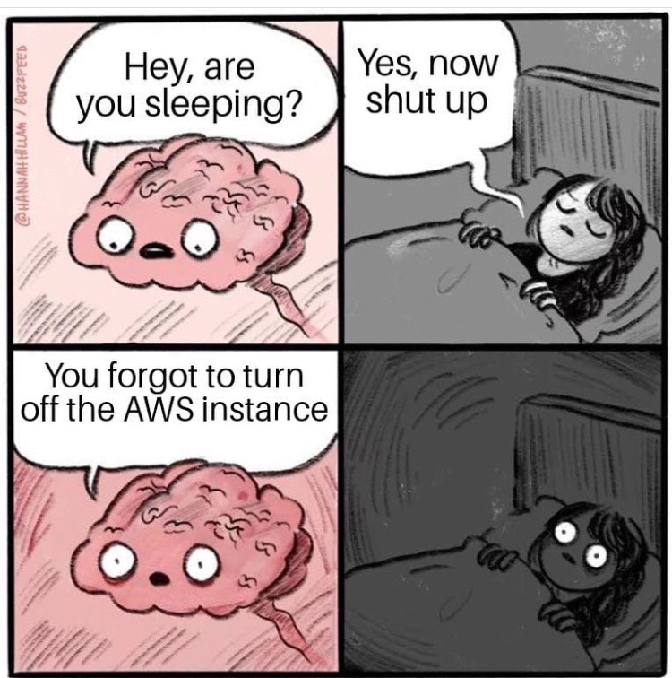

---

title: "AWS Security Monitoring Tools & Services: A Real Stack From $25/Month"
date: 2025-05-19
lastmod: 2026-11-24
draft: false
description: "Which AWS security monitoring tools and services to actually use — CloudTrail, GuardDuty, EventBridge, Config, Security Hub, plus open-source Wazuh — and how to combine them without Splunk or Datadog."
slug: "affordable-aws-security-monitoring"
tags: ["aws", "cloud security", "monitoring", "siem", "cloudtrail", "eventbridge", "wazuh"]
keywords: ["aws security monitoring", "aws security monitoring tools", "aws security monitoring services", "aws security monitoring best practices", "aws threat detection setup", "aws siem alternative", "cloudtrail security monitoring", "eventbridge alerting", "wazuh aws", "aws monitoring without splunk"]
aliases: ["/aws-cost-effective-monitoring/"]
summary: "How to build a real AWS security monitoring stack without enterprise pricing — using CloudTrail, EventBridge, GuardDuty, and open-source tools like Wazuh and OpenSearch."
canonicalURL: "https://thehiddenport.dev/posts/affordable-aws-security-monitoring/"
enable_comments: true
---

> Monitoring in AWS doesn’t have to be expensive. This guide covers the AWS security monitoring tools and services worth using — native ones like CloudTrail, GuardDuty, EventBridge, Config, and Security Hub, plus open-source options like Wazuh and OpenSearch — and how to combine them into a stack that costs roughly $25–75 a month instead of a SIEM contract.

**The AWS security monitoring tools at a glance:**

| Tool / service | What it gives you | What drives the cost |
|---|---|---|
| **CloudTrail** | Audit log of every API call — who did what, and when | 90-day event history is free; trails cost S3 storage |
| **CloudWatch Logs + metric filters** | Alerts on specific events (root login, access denied, SG changes) | GB ingested and retention period |
| **EventBridge** | Routes findings and events to Lambda, SNS, Slack | Negligible at moderate volume |
| **AWS Config** | Flags misconfigured resources (public S3, CloudTrail disabled) | Per rule evaluation |
| **GuardDuty** | Managed threat detection: credential misuse, recon, crypto mining | Volume of data analyzed (30-day free trial) |
| **Security Hub** | One place for findings + compliance scoring | Checks and findings ingested (30-day free trial) |
| **Wazuh / OpenSearch** | Self-hosted SIEM and search over your logs | The instances you run them on |

## Introduction

When people talk about security monitoring in AWS, the conversation quickly jumps to expensive SIEM tools or overengineered pipelines. But if you're running lean, or just want better control over where your money is going, you can achieve excellent security visibility with **surprisingly low cost**.

This article breaks down how to do exactly that.

We’ll cover:

* Which AWS services give you security telemetry for free (or close to it)
* How to set up event-driven alerts with minimal runtime costs
* Open-source options that plug into AWS without turning into money pits
* Architecture patterns for teams of all sizes

By the end, you'll have a solid strategy that keeps your AWS environments monitored — without needing to sell an organ.




---

## Why AWS Monitoring Costs Spiral

Understanding the **primary cost drivers** helps you design smarter from the start:

* **CloudWatch Logs**: billed by ingestion volume *and* retention duration.
* **CloudTrail**: multi-region trails with long-term S3 storage + optional CloudTrail Lake.
* **AWS Config**: charges per rule evaluation.
* **Athena queries**: priced per TB scanned — expensive if used without partitions.
* **SIEM integrations**: agents like Datadog or Rapid7 can multiply costs fast.

Add to that naive setups like "log everything forever" or "query daily with no filters," and you're in trouble.

---

## Key Principles for Cost-Effective Monitoring

1. **Start with native tools**: AWS services like EventBridge, CloudTrail, and Config already provide tons of signal.
2. **Event-driven > polling**: Trigger Lambdas from EventBridge or GuardDuty rather than running scheduled functions.
3. **Don't store what you won’t analyze**: Be selective about what you keep beyond 30–90 days.
4. **Use cold storage smartly**: S3 + Glacier Deep Archive = cheap long-term retention.
5. **Treat logs as tiered assets**: hot (analyzed), warm (queryable), cold (archived).

---

## Low-Cost Native AWS Tools for Security Monitoring

### 🔍 **CloudTrail**

* Captures API-level activity.
* **Free for 90 days in Event History**.
* For long-term: use an org-wide trail → S3 + lifecycle policy.

**What to watch for:**

* `ConsoleLogin`
* `AssumeRole`
* `UnauthorizedOperation`

Use EventBridge rules or metric filters on these events to alert.

---

### 📈 **CloudWatch Logs & Metric Filters**

* Logs cost per GB ingested and retained.
* Set up **metric filters** on important events (from CloudTrail logs) to track threats.

**Example filters:**

* Root login usage
* Access denied errors
* Security group changes

Pair with CloudWatch Alarms to notify via SNS.

---

### 🎯 **EventBridge**

* Serverless event router.
* Filter and forward events to Lambda, SNS, or other targets.

**Use for:**

* Security Hub findings
* IAM changes
* GuardDuty alerts

Pricing is negligible at moderate volume.

---

### ⚙️ **AWS Config (targeted)**

* Only enable the **rules you care about**, like:

  * S3 bucket public access
  * IAM root usage
  * CloudTrail enabled

Stay under the free tier (100 evaluations/month) or use it sparingly.

---

### 🚨 **Security Hub + GuardDuty**

* Free for 30 days, then priced by finding volume.
* Use with EventBridge to auto-respond only to **High/Medium** severity.

---

## Open-Source Solutions That Complement AWS

### 🛡️ **Wazuh**

* Lightweight SIEM alternative
* Deploy in ECS Fargate Spot or EC2 `t3a.small`
* Collect CloudTrail logs via Filebeat
* Store in S3 with lifecycle policies

**Bonus**: enrich with GeoIP, threat feeds, file integrity monitoring

---

### 🔍 **OpenSearch (self-hosted)**

* Use a minimal cluster (e.g., 2 nodes in `t3.medium`) or serverless preview
* Avoid expensive retention — snapshot to S3 after 7–14 days
* Kibana dashboards for audit logs, login attempts, or GuardDuty

---

### 📊 **Prometheus + Grafana**

* Use `cloudwatch_exporter` to pull metrics securely
* Great for EC2 / Lambda / API Gateway visibility
* Host Grafana in AWS Amplify or Fargate

---

## Example Architectures & Pricing

### 💡 Single-Account / Starter Org (under \$25/mo)

* CloudTrail → S3 + 30-day lifecycle
* CloudWatch Log group for VPC flow logs (1 env)
* Metric filters for key events
* EventBridge + Lambda notifications

### 🧠 10-Account Org (under \$75/mo)

* Org-level CloudTrail
* Centralized logging bucket
* Athena for on-demand queries (partitioned)
* GuardDuty in key regions

### 🧰 Hybrid Open Source (under \$60/mo)

* Wazuh on Spot EC2 / Fargate
* Logs ingested into OpenSearch for 7 days
* Archived to S3 Glacier after

---

## Automation Snippets for Cost-Efficient Alerts

### 🎯 EventBridge Rule (UnauthorizedOperation)

```json
{
  "source": ["aws.cloudtrail"],
  "detail-type": ["AWS API Call via CloudTrail"],
  "detail": {
    "errorCode": ["UnauthorizedOperation"]
  }
}
```

### 📏 CloudWatch Metric Filter (Root Login)

```bash
filter pattern: "$.userIdentity.type = \"Root\" && $.eventName = \"ConsoleLogin\""
```

### 🔔 SNS Notification from Lambda

```python
import boto3
sns = boto3.client("sns")
sns.publish(
  TopicArn="arn:aws:sns:region:account:topic",
  Message="Root login detected!",
  Subject="Security Alert"
)
```

---

## Common Pitfalls to Avoid

* **Over-collecting VPC flow logs** (use `sampled` mode for dev)
* **Ignoring storage lifecycle** → logs build up, cost you
* **Enabling every AWS Config rule** → high evaluation cost
* **Too many EventBridge rules** → simplify to key patterns
* **Relying on vendor agents for everything**

---

## Conclusion

Security monitoring in AWS doesn’t have to be expensive — it just has to be intentional.

Start with native tools. Build in automation. Store smart. And grow from there.

With this approach, you can:

* Stay compliant
* Detect threats
* Reduce your cloud bill

If this helped you rethink your AWS monitoring setup, consider subscribing to [The Hidden Port](https://thehiddenport.dev) — where we explore more real-world strategies like this, every week.

---

**Related guides:**

* [AWS Incident Response Guide for Small Security Teams](/posts/incident-response-aws-guide/)
* [IAM Users Are Dead: Modern AWS Access Control for 2026](/posts/aws-iam-users-alternatives)
* [Amazon GuardDuty Setup: Findings, Alerts & SIEM Integration](/posts/aws-guardduty-setup/)
* [GuardDuty vs Security Hub: What Each Does and When You Need Both](/posts/aws-guardduty-vs-security-hub/)
* [Secrets Manager Now Sends Events to EventBridge](/posts/aws-secrets-manager-eventbridge-notifications/)
* [AWS Security Checklist 2026: 30+ Controls for IAM, EC2 & S3](/posts/aws-security-checklist-2026/)
